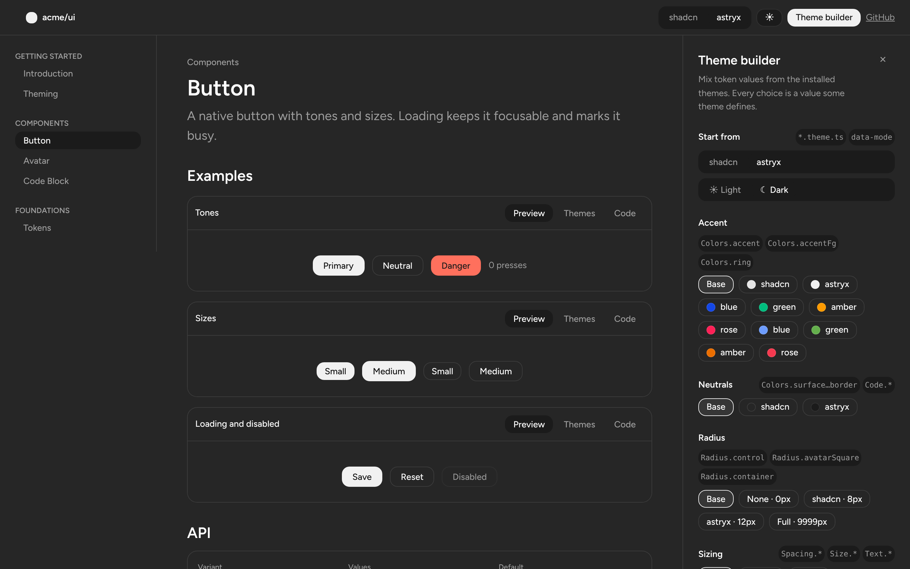

# acme/ui: a design system for @effect/ui-kit (PoC)

Typed tokens → Schema-backed variants → per-part styles for
[`@effect/ui-kit`](https://github.com/Effect-TS/ui), compiled to static CSS at build time by our own
Effect-based engine. Components are written against a **token contract** (names and kinds only);
**themes** fill the contract in. Swap the theme, keep the components.



## Setup

`@effect/ui` isn't on npm yet. It's pinned as a git submodule at `vendor/effect-ui`
(commit `9dc3482`) and linked with `link:`; the kit ships `.ts` source, so there's no build step.

pnpm installs packages; everything runs on **Bun 1.4.5** (the Rust rewrite), pinned as a dev
dependency. The docs app's entry, `apps/docs/docs.build.ts`, is one Effect program on
`BunRuntime` with `dev`, `build` and `preview` commands; it owns the CSS engine's services for the
whole run. Vitest runs under Bun with the `threads` pool and without its file-system module cache
(the cache key doesn't cover the CSS engine's generated code).

```bash
git submodule update --init
pnpm install
pnpm docs    # live examples + their source, theme switcher, theme builder
pnpm ci      # oxfmt → oxlint + ast-grep → tsc (TypeScript 7) → every package's tests → rule tests → docs build
```

### Deploying the docs

`apps/docs/alchemy.run.ts` is an [Alchemy](https://alchemy.run/cloudflare/) stack: a Cloudflare
`Website.StaticSite` that runs the docs build and serves `dist/` with single-page-app fallback.
State lives in Alchemy's Cloudflare state store, so CI needs no local state.

Pushing a `v*` tag runs `.github/workflows/deploy-docs.yml`: `pnpm ci`, then
`alchemy deploy --stage prod`. It needs two repository secrets, `CLOUDFLARE_API_TOKEN` and
`CLOUDFLARE_ACCOUNT_ID`. To deploy by hand:

```bash
cd apps/docs && bun alchemy deploy --stage prod
```

## Packages

Every package with real code, and the docs app, has the same `src/` layout
(`+rule/feature-folders/feature-folders.md`): `feature/<name>/` for a self-contained capability,
`platform/<name>/` for what features stand on and what puts them together. A feature never
imports another feature.

```
packages/
  design-system/   @acme/design-system: the generic library. No ui-kit, no CSS engine.
    src/platform/token/      token.pure.ts, token-color.make.ts, … (one make per kind)
    src/platform/kit/        Kit.make / Kit.makeSingle: the parts-and-states descriptor type
    src/platform/variant/    Variant.make(Schema, …), Variant.makeFlag(…)
    src/platform/manifest/   tokens + components, as data
    src/platform/compile/    the adapter for @acme/css-engine
    src/feature/style/       Style.make(Parts)({ … }), getStyleClasses, Element.make(Style)
    src/feature/theme/       Theme.make(Tokens, { name, values, modes })
  components/      @acme/components
    src/platform/token/      🔒 contract.token.ts: the token contract
    src/platform/scale/      🔒 scales.schema.ts: variant value lists
    src/platform/manifest/   every style and the contract, as data
    src/feature/<name>/      button avatar code-block layout text swatch:
                             parts.constant, component.style, component (+ define/update/view/command)
  themes/          @acme/theme-shadcn, @acme/theme-astryx   (<name>.theme.ts)
  css-engine/      @acme/css-engine: generic, Effect-based, no design-system knowledge
    src/platform/            rules (the adapter contract), css, hash, message, engine, vite
    src/feature/             recipe (+ the browser runtime), codegen
apps/docs/         composed only from @acme/components; routed with Route + BrowserRouter
  src/main.ts                mount App with BrowserRouter.layer
  src/platform/app/          app.route (Route.union), schema, define, update, subscription, view, component
  src/platform/{theme,content,example,ui}/   shared by the pages
  src/feature/{introduction,theming,component-docs,tokens}/   x.route.ts + x.view.ts
  src/feature/theme-builder/ schema, define, update, view, component, customize.pure(.map/.predicate)
tools/lint/        finds every +rule/<rule>/<rule>.{lint.ts,yml}, runs them, tests every <rule>.md (all Effect programs)
  src/platform/{kind,rule-module,discover}/   file kinds, the rule-module helper, finding +rule folders
  src/feature/oxlint/        the oxlint plugin (loads every <rule>.lint.ts)
  src/feature/ast-grep/      runs every <rule>.yml
  test/rules.test.ts         runs every ✅/❌ example
```

No barrels: each package lists its modules in `package.json` `exports`
(`@acme/design-system/TokenColor`, `@acme/components/button`, …).

## Rules: `+rule/<rule>/<rule>.{md,yml,lint.ts}`

Every convention is written down and checked in a `+rule/<rule>/` folder next to the code it covers.
A rule applies to files of its kind in the folder holding `+rule/`, and below.

| file             | role                                                                | read by                                                        |
| :--------------- | :------------------------------------------------------------------ | :------------------------------------------------------------- |
| `<rule>.md`      | **the contract**: what's allowed and why, ✅/❌ examples. Required. | people, agents, `pnpm test:rules`                              |
| `<rule>.yml`     | **shape**: what a file may export and import                        | ast-grep (`tools/lint/src/feature/ast-grep/ast-grep.build.ts`) |
| `<rule>.lint.ts` | **meaning**: file system, scopes, values, comments                  | oxlint via effect-oxlint (`oxlint.config.ts`)                  |

The ✅/❌ blocks in each `<rule>.md` are the rule tests. Each ✅ passes both tools, and each ❌
fails with the id its heading names (`→ component-style-files/tokens-only`).

| rule                    | where                 | covers                                                                                           |
| :---------------------- | :-------------------- | :----------------------------------------------------------------------------------------------- |
| `allowed-file-kinds`    | root                  | allowed kinds, kebab-case names, a rule doc above every file, colocated tests, no barrels        |
| `no-comments`           | root                  | no comments in any `.ts`, except `@ts-expect-error` and `// Arrange / Act / Assert` in tests     |
| `component-parts`       | root                  | define/update/view/command/subscription/route files; Commands only in `*.command.ts`             |
| `feature-folders`       | root                  | `src/feature/*` and `src/platform/*` only; a feature never imports another feature               |
| `function-names`        | root                  | names by file kind: get/compose, mapXToY, is/has/should, make…, …Schema                          |
| `no-ternary`            | root                  | no `a ? b : c`: branch with `Match` from `effect`                                                |
| `pure-files`            | root                  | data kinds have no effects; `*.pure.ts` exports only functions and has a `*.pure.test.ts`        |
|                         |                       | exported pure functions take one Schema-typed object; mappers and predicates get their own files |
| `types-from-schema`     | root                  | data shapes are Schemas (`typeof X.Type`); only generic and function types stay plain            |
| `schema-files`          | root                  | a `*.schema.ts` exports only Schemas, and imports only `effect`, `@effect/ui` and schemas        |
| `constant-files`        | root                  | a `*.constant.ts` exports values, no functions                                                   |
| `make-files`            | root                  | a `*.make.ts` exports `make`                                                                     |
| `test-files`            | root                  | tests import `@effect/vitest`, and every test is `// Arrange`, `// Act`, `// Assert`             |
| `component-files`       | `packages/components` | a library component: `Html.component`, a view function or `Element.make(Style)`                  |
| `component-files`       | `apps/docs`           | an app component: an `Html.component`; examples also export `title` and `order`                  |
| `component-style-files` | `packages/components` | only `Style.make(…)` exports, tokens only, `@acme/*` imports only                                |
| `token-files`           | `packages/components` | the contract: only `Token*.make(…)` groups                                                       |
| `theme-files`           | `packages/themes`     | only `Theme.make(Tokens, …)`                                                                     |
| `build-files`           | `packages/css-engine` | build-time Node code (doc only)                                                                  |

## The CSS engine: `@acme/css-engine`

```ts
makePlugin({ include: /\.(component\.style|theme)\.ts$/, adapter: "@acme/design-system/Compile" })
```

- **Evaluate:** each file matching `include` is loaded in Node through an internal Vite module runner.
- **Adapt:** the adapter (`compile(value, exportName)`) turns each export into plain rules (`rules.pure.ts`):
  recipes (a class per variant value) and global rules.
- **Write:** pure functions serialise the rules (`css.pure.ts`), name classes (`hash.pure.ts`: readable in dev,
  short in builds) and generate the importer's module (`codegen.pure.ts`). That module imports a virtual CSS
  file and a ~20-line browser runtime (`runtime.pure.ts`) that picks variant classes.
- **Effect:** `engine.build.ts` is an Effect program over a `ModuleLoader` service, with typed
  `EvaluationError` / `AdapterError`. The Vite plugin runs it on a `ManagedRuntime` whose layer owns the
  inner Vite server (acquired and released as a scoped resource). A bad theme value fails the build with
  a typed `InvalidTokensError` and its path.
- **Hosts:** dev with hot reload, vitest, and production builds. `packages/css-engine/test` compiles a fixture
  with a fixture adapter, with no design system.

## Authoring in one screen

```ts
// components/src/contract.token.ts: names and kinds
export const Colors = TokenColor.make("color", ["surface", "fg", "accent", "accentFg", "danger"])
export const Tokens = { Colors /* … */ }

// themes/astryx/src/astryx.theme.ts: values, checked against the contract
export const astryx = Theme.make(Tokens, { name: "astryx", values: { Colors: { accent: "#1b1b1b" /* … */ } /* … */ } })

// components/src/layout/center.component.ts: a styled element is one line
export const Center = Element.make(CenterStyle)

// components/src/button/button.component.style.ts: how it looks
export const ButtonStyle = Style.make(ButtonParts)({
  base: { root: { borderRadius: Radius.control, states: { disabled: { opacity: 0.5 } } } },
  variants: { tone: Variant.make(Tone, { primary: { root: { background: Colors.accent } } /* … */ }) }
})

// an app
import "@acme/theme-astryx"
Layout(h.div)
  .attr("data-theme", "astryx")
  .attr("data-mode", "dark")
  .children(
    LayoutContent(h.main).children(
      HStack(h.div, { gap: "3" }).children(
        Avatar(h, { name: "Ada Lovelace" }),
        Button(h, { tone: "primary", onPress: Msg.Saved(), children: "Save" })
      )
    )
  )
```
