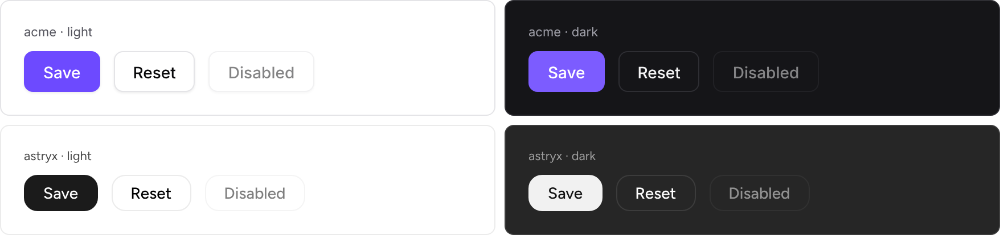

# acme design system (PoC)

Typed tokens → Schema-backed variants → per-part styles for
[`@effect/ui-kit`](https://github.com/Effect-TS/ui), compiled to static CSS with vanilla-extract.
Components and themes are separate packages: components are written against a **token contract**
(names and kinds only), and any theme that fills in the contract can style them.



## Setup

`@effect/ui` isn't on npm yet. It's pinned as a git submodule at `vendor/effect-ui`
(commit `9dc3482`) and linked with `link:`; the kit ships `.ts` source, so there's no build step.

```bash
git submodule update --init
pnpm install
pnpm check   # tsc in every package, including the must-not-compile cases
pnpm test    # server render + manifest
pnpm docs    # docs app: live examples + their source, theme switcher, side-by-side compare
```

## Layout

```
packages/
  ds/                  @acme/ds          the generic library
    src/TokenColor.ts TokenLength.ts TokenFont.ts TokenWeight.ts TokenShadow.ts TokenDuration.ts
    src/Theme.ts Variant.ts Style.ts DesignSystem.ts
    src/kit/button.ts kit/avatar.ts       the ONLY files that know ui-kit's DOM (parts, data attributes)
  components/          @acme/components  Button + Avatar
    src/tokens.ts  🔒  the token contract (names + kinds, no values)
    src/scales.ts  🔒  Tone, Size, AvatarSize, Shape, Hue
    src/button.css.ts avatar.css.ts index.ts
  themes/acme/         @acme/theme-acme   🔒 violet, Inter, 8px corners (default, also on :root)
  themes/astryx/       @acme/theme-astryx 🔒 Astryx-inspired: near-black accent, Figtree, 12px corners
apps/
  docs/                examples/<component>/*.ts are rendered live AND shown as source (import.meta.glob + ?raw)
  playground/          the handover's Editor example + a shadcn/ui Button rebuilt on @acme/ds
```

## Authoring in one screen

```ts
// components/src/tokens.ts: the contract
export const Colors = TokenColor.make("color", ["surface", "fg", "accent", "accentFg", "danger"])
export const Radius = TokenLength.make("radius", ["control", "full"])
export const Tokens = { Colors, Radius, /* … */ }

// themes/astryx/src/theme.css.ts: values, checked against the contract
export const astryx = Theme.make(Tokens, {
  name: "astryx",
  values: { Colors: { accent: "#1b1b1b", … }, Radius: { control: 12, full: 9999 }, … },
  modes: { dark: { Colors: { accent: "#f1f1f1", … } } },
})                       // → [data-theme="astryx"] and [data-theme="astryx"][data-mode="dark"]

// components/src/button.css.ts: styles reference the contract only
export const ButtonStyle = Style.make(Button)({
  base: { root: { borderRadius: Radius.control, states: { disabled: { opacity: 0.5 } } } },
  variants: { tone: Variant.make(Tone, { primary: { root: { background: Colors.accent } }, … }) },
})

// app
import "@acme/theme-astryx"
h.div.attr("data-theme", "astryx").attr("data-mode", "dark").children(
  Button(h, { tone: "primary", onPress: Msg.Save(), children: "Save" }),
  Avatar(h, { name: "Ada Lovelace", src: user.photo }),
)
```

Packages that author `.css.ts` files need `@vanilla-extract/css` (and `@vanilla-extract/recipes`
for styles) as direct dependencies, because the compiled output imports them.
