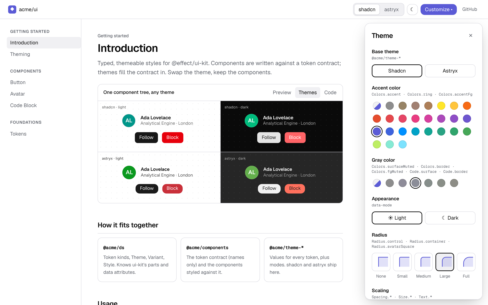

# acme/ui: a design system for @effect/ui-kit (PoC)

Typed tokens → Schema-backed variants → per-part styles for
[`@effect/ui-kit`](https://github.com/Effect-TS/ui), compiled to static CSS with vanilla-extract.
Components and themes are separate packages: components are written against a **token contract**
(names and kinds only), and any theme that fills in the contract can style them.



## Setup

`@effect/ui` isn't on npm yet. It's pinned as a git submodule at `vendor/effect-ui`
(commit `9dc3482`) and linked with `link:`; the kit ships `.ts` source, so there's no build step.

```bash
git submodule update --init
pnpm install
pnpm docs    # docs app: live examples + their source, theme switcher, side-by-side compare
pnpm ci      # oxfmt --check → oxlint → tsc (TypeScript 7) → vitest → docs build
```

| script       | what                                                                                                                                                                       |
| :----------- | :------------------------------------------------------------------------------------------------------------------------------------------------------------------------- |
| `pnpm check` | one TypeScript 7 program over the whole repo (~2.5s), including the must-not-compile cases                                                                                 |
| `pnpm lint`  | oxlint, plus a local plugin (`tools/oxlint-plugin-acme.mjs`): raw colours / lengths / durations and lint-disable comments are errors in `packages/components/src/*.css.ts` |
| `pnpm fmt`   | oxfmt                                                                                                                                                                      |
| `pnpm test`  | server render + manifest                                                                                                                                                   |

## File kinds

Every file under `packages/*/src`, `packages/themes/*/src`, `apps/*/src` and `test/` must be one of these.
`acme/file-kind` rejects anything else.

| file                                           | what it may contain                                                                                                                                               | enforced by                                                                         |
| :--------------------------------------------- | :---------------------------------------------------------------------------------------------------------------------------------------------------------------- | :---------------------------------------------------------------------------------- |
| `*.component.ts`                               | must define an `Html.component`                                                                                                                                   | ast-grep `component-defines-component`                                              |
| `*.pure.ts`                                    | pure functions and data: no `window`/`document`/`console`/`fetch`…, no `Math.random`/`Date.now`/`new Date`, no top-level `let` or statements, no `Html.component` | oxlint `acme/pure`, ast-grep `pure-has-no-component`                                |
| `*.css.ts`                                     | vanilla-extract styles and themes. In `@acme/components`, tokens only (no raw colours, lengths or durations, no lint-disable comments)                            | oxlint `acme/tokens-only`, ast-grep `css-has-no-runtime`                            |
| `*.vanilla.ts`                                 | build-time APIs that call vanilla-extract (`Theme.make`, `Style.make`)                                                                                            | oxlint `acme/vanilla-imports`: `@vanilla-extract/*` only in `.css.ts`/`.vanilla.ts` |
| `index.ts`                                     | re-exports only                                                                                                                                                   | ast-grep `index-reexports-only`                                                     |
| `main.ts`                                      | app entry (apps only)                                                                                                                                             | oxlint `acme/file-kind`                                                             |
| `*.d.ts`, `test/*.test.ts`, `test/*.test-d.ts` | declarations and tests                                                                                                                                            | oxlint `acme/file-kind`                                                             |

Package `exports` keep public paths free of kinds: `@acme/ds/kit/button`, `@acme/components/tokens`.

## Layout

```
packages/
  ds/                  @acme/ds          the generic library
    src/Token*.pure.ts                    one module per token kind
    src/Theme.vanilla.ts Style.vanilla.ts Variant.pure.ts DesignSystem.pure.ts highlight.pure.ts
    src/kit/button.pure.ts kit/avatar.pure.ts   the ONLY files that know ui-kit's DOM (parts, data attributes)
    src/kit/code-block.component.ts             CodeBlock has no ui-kit counterpart: the DS owns its DOM
  components/          @acme/components  Button, Avatar, CodeBlock
    src/tokens.pure.ts  🔒  the token contract (names + kinds, no values)
    src/scales.pure.ts  🔒  Tone, ControlSize, AvatarSize, Shape, Hue, CodeTone
    src/button.css.ts avatar.css.ts code-block.css.ts library.pure.ts index.ts
  themes/shadcn/       @acme/theme-shadcn 🔒 shadcn/ui neutral, Geist (default, also on :root)
  themes/astryx/       @acme/theme-astryx 🔒 Astryx-inspired: near-black accent, Figtree, 12px corners
apps/
  docs/                examples/<component>/*.component.ts are rendered live AND shown as source;
                       component styles, the contract and themes are shown from the real files (?source);
                       a theme customizer whose controls map to contract tokens and export a Theme.make file
tools/lint/          effect-oxlint plugin (file-kind, pure, vanilla-imports, tokens-only)
tools/ast-grep/      structural rules for file kinds
```

## Authoring in one screen

```ts
// components/src/tokens.ts: the contract
export const Colors = TokenColor.make("color", ["surface", "fg", "accent", "accentFg", "danger"])
export const Radius = TokenLength.make("radius", ["control", "full"])
export const Tokens = { Colors, Radius, /* … */ }

// themes/astryx/src/theme.css.ts: values, checked against the contract
export const astryx = Theme.make(Tokens, {
  name: "astryx",
  values: { Colors: { accent: "#1b1b1b", … }, Radius: { control: 12, full: 9999 }, … },
  modes: { dark: { Colors: { accent: "#f1f1f1", … } } },
})                       // → [data-theme="astryx"] and [data-theme="astryx"][data-mode="dark"]

// components/src/button.css.ts: styles reference the contract only
export const ButtonStyle = Style.make(Button)({
  base: { root: { borderRadius: Radius.control, states: { disabled: { opacity: 0.5 } } } },
  variants: { tone: Variant.make(Tone, { primary: { root: { background: Colors.accent } }, … }) },
})

// app
import "@acme/theme-astryx"
h.div.attr("data-theme", "astryx").attr("data-mode", "dark").children(
  Button(h, { tone: "primary", onPress: Msg.Save(), children: "Save" }),
  Avatar(h, { name: "Ada Lovelace", src: user.photo }),
)
```

Packages that author `.css.ts` files need `@vanilla-extract/css` (and `@vanilla-extract/recipes`
for styles) as direct dependencies, because the compiled output imports them.
